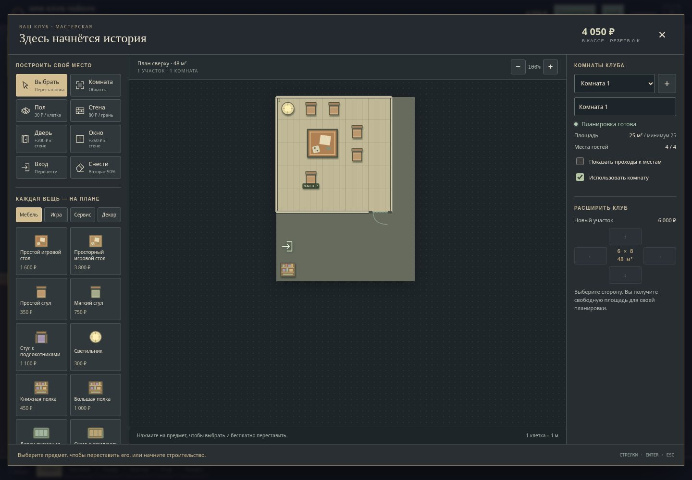

# НРИ-Клуб-Тайкун: ход разработки

Обновлено: 19 октября 2026, 09:04 UTC.

Это страница текущих этапов. Завершённая опубликованная игра пока не подтверждена.

| Этап | Статус | Критерий проверки |
| --- | --- | --- |
| Перенос существующей игры | Выполнено | Архив скачан штатно, SHA-256 и все 79 файлов manifest совпали; 134 теста и статическая проверка прошли |
| Персонажи, посадка, очередь, независимые партии | Реализовано; облачная проверка интерфейса впереди | Перетаскивание на стул, обмен, автоматический следующий гость, разные окончания и сохранение остальных партий |
| Рейтинг и подбор компаний | Формула и сравнение проверены | На одинаковых seed разумные решения лучше случайных и плохих; обязательные границы соблюдаются; старые отзывы сохраняются |
| Конструктор клуба | Реализован; проверен в Chromium | Вид сверху по сетке; свободные стены, двери, мебель и оборудование; расширение площади; проход от входа до каждого места |
| Экономика и развитие | Реализовано; проверяется длинная кампания | Одна комната на старте, покупки и найм, обязательная почасовая зарплата, отказ недовольных платить, чаевые, расходы и настоящее банкротство |
| Обучение и управление | Реализовано; основные действия проверены | Понятный первый цикл, выбор купленной игры и нанятого мастера, доступность с телефона и клавиатуры |
| Полная проверка | В работе | Автотесты, сохранения и миграции, реальная браузерная проверка desktop/mobile и кампании |
| GitHub Pages | Не опубликовано | Открывается публичная версия с теми же исходниками, пройден основной цикл |

## Как будет работать конструктор

Клуб виден сверху на клетчатом плане. Игрок размечает комнаты и коридоры, рисует стены, ставит двери, столы, стулья, свет и купленное оборудование. Каждая покупка появляется на карте. Площадь расширяется новыми участками, которые игрок обустраивает сам.

Помещение становится рабочей игровой комнатой, когда в нём есть стол, четыре гостевых места, место мастера, свет, купленная игра и нанятый мастер. Проверка проходимости учитывает стены, двери и мебель: от входа должен существовать путь к каждому месту. Недостроенную или перекрытую комнату запустить нельзя.

## Что уже проверено в облаке

- В Chromium собрана вторая комната через настоящий конструктор: участок, 25 клеток, стены, дверь, стол, пять стульев, свет. До каждого места есть настоящий путь.
- Проверены покупка, бесплатная перестановка и продажа предмета; расширение площади; мышь, касания, клавиатура и Escape. На экранах 320/390 px нет горизонтального переполнения страницы.
- В основном интерфейсе проверены настоящее перетаскивание гостя, следующий ожидающий, отдельный запуск без перемотки, перезагрузка идущей игры, четыре отзыва и индивидуальные платежи. Ошибок JavaScript не обнаружено.
- На одинаковом пуле из 30 гостей плохой, случайный и разумный подбор дали средние 2,538 / 4,422 / 7,000; доли оплативших 0% / 26,5% / 77,5%. Обязательные условия соблюдены. Это сравнительный аудит, а не доказательство полной кампании.
- Длительная кампания, окончательные миграции и публикация ещё проверяются. Первичное включение GitHub Pages требует отдельного доступного административного действия; публичная игра пока не подтверждена.

### Конструктор в Chromium

[Мобильный экран конструктора](evidence/constructor-mobile.jpg).

Статусы обновляются после значимых проверенных этапов. «В работе» и «Не проверено» не означают готовность.

