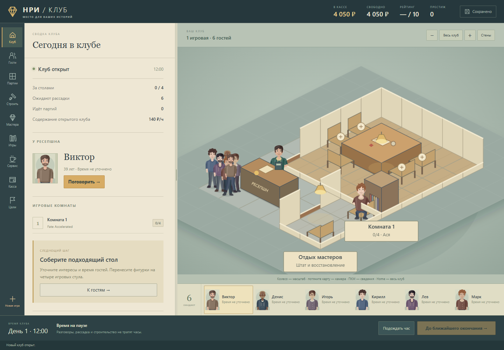

# НРИ-Клуб-Тайкун

Управляйте клубом настольных ролевых игр: встречайте гостей у ресепшна, узнавайте их интересы, собирайте компании, нанимайте мастеров и расширяйте помещение.

Переделка от **N5 / `912f32b`**, 20 октября 2026. Карта, строительство, разговоры, магазин, сервис и финансы собраны в одном интерфейсе. Последнее обновление: [открытый тайкун без завершения по числу комнат, развитие и рост штата](docs/OPEN-TYCOON.md). Экономика — в [расчётах трёх экономистов](docs/ECONOMY-BALANCE.md). История и границы переделки — в [описании](docs/REWORK.md).

## Запуск

Нужен Node.js 22 или новее. На Windows откройте **Start-Club.cmd**. Либо выполните `npm start` в каталоге проекта и откройте **http://127.0.0.1:8174**. Установка пакетов для игры не нужна. Закройте окно запуска, чтобы остановить локальный сервер.

Открывайте игру через сервер: при открытии `index.html` как файла браузер блокирует модули и сохранения. Для размещения на сайте достаточно статических файлов этого проекта.

## Первые шаги

1. Нажмите на ресепшн или выберите гостя в нижней очереди. Нажмите «Короткое знакомство»: основные ответы запишутся одним разговором.
2. Перетащите портрет на свободный стул либо выберите место кнопкой в панели гостя.
3. В разделе «Партии» подберите игру, приключение и мастера. Часы задаёт история; билет стоит 200 ₽ с гостя за час. Проверьте расчёт дохода и расходов, затем запустите подготовленную комнату.
4. Кнопка «До ближайшего окончания» продвигает время. Каждая комната заканчивает свою сессию отдельно; отзывы и расчёт появятся в кассе.
5. В разделе «Строить» расширяйте участок, рисуйте комнаты и размещайте оснащение. Перед подтверждением видны цена, размещение и причина запрета.

Размер клуба выбираете вы: достигнутые вехи отмечаются в «Развитии», после них игра продолжается.

Разговоры, рассадка и строительство проходят на паузе. Время продвигается кнопками нижней панели.

## Управление картой

| Действие | Управление |
| --- | --- |
| Переместить камеру | Тянуть пустое место; средняя кнопка; пробел + перетаскивание |
| Масштаб у указателя | Колесо мыши; на телефоне — щипок двумя пальцами |
| Переместить камеру с клавиатуры | WASD или стрелки |
| Показать весь клуб | Home или кнопка «Весь клуб» |
| Сведения о предмете | Правая кнопка мыши |
| Повернуть размещаемый предмет | R, включая русскую раскладку |
| Отменить текущий инструмент | Escape |

Ширину боковой панели можно менять за её правый край. На узком экране карта расположена над панелью; очередь гостей остаётся отдельной полосой интерфейса.

## Сохранения

Клуб автоматически сохраняется в браузере после успешного действия. В «Настройках» доступны скачивание и загрузка файла. Импорт и новая игра требуют подтверждения прямо в панели; прежняя запись архивируется в хранилище браузера. Повреждённую исходную запись можно скачать до создания новой.

Сохранения привязаны к адресу сайта. Для переноса с опубликованной N5 на локальную версию сначала скачайте файл сохранения в старой игре, затем загрузите его здесь. Сохранения другого адреса не переносятся автоматически. При открытии одного клуба в двух вкладках изменение разрешено только одной из них.

## Проверка

`npm test` запускает 117 проверок модели без сторонних пакетов. Браузерный сценарий, его окружение и итоговые отчёты описаны в [docs/REWORK.md](docs/REWORK.md) и [последнем обновлении](docs/OPEN-TYCOON.md). В тестах браузера звук принудительно отключён.

Документы `GAME_DESIGN.md`, `ROADMAP.md`, `CLUB_CYCLE.md`, `PROGRESS.md` и `RECOVERY.md` сохраняют историю проекта; актуальный объём этой переделки указан в `docs/REWORK.md`.
