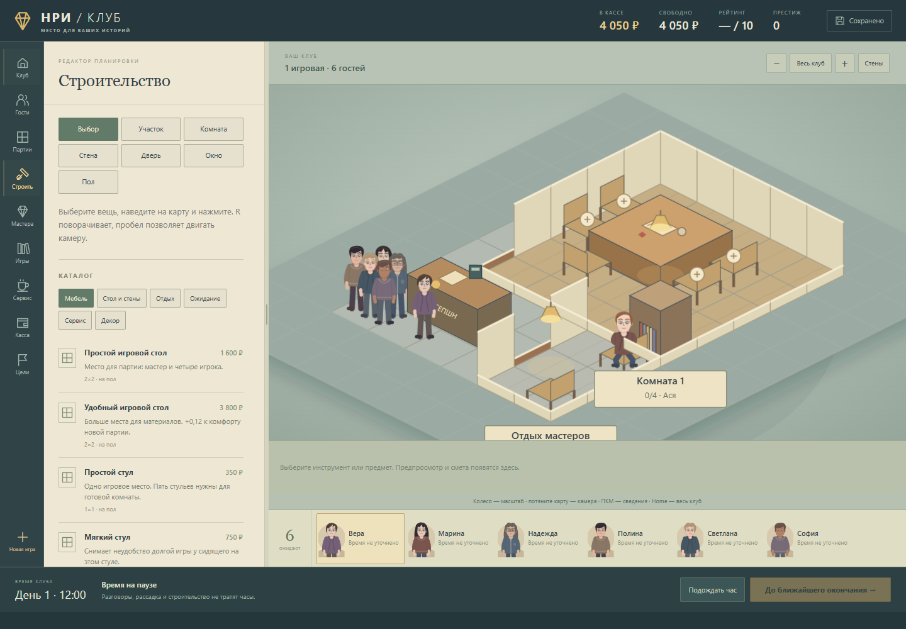
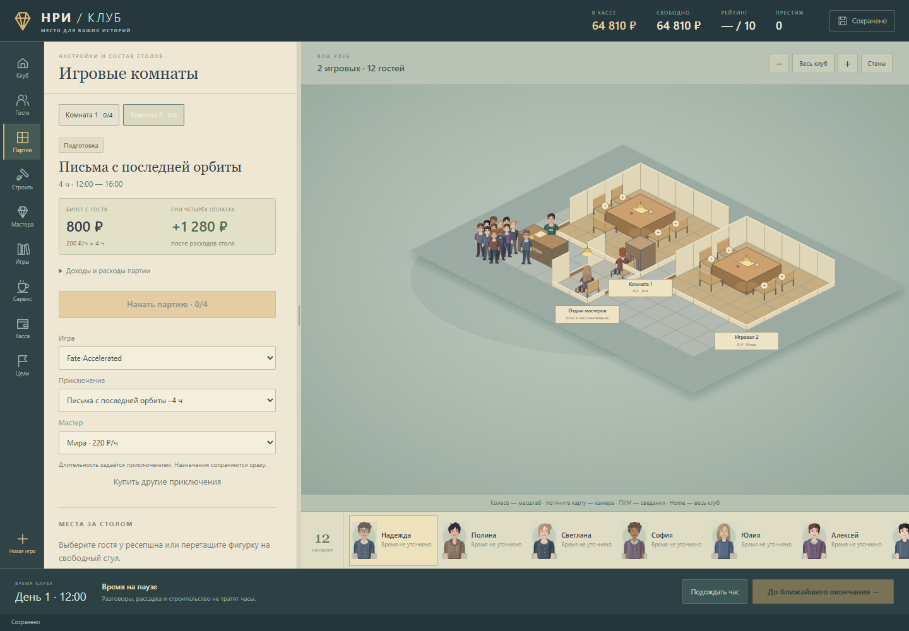
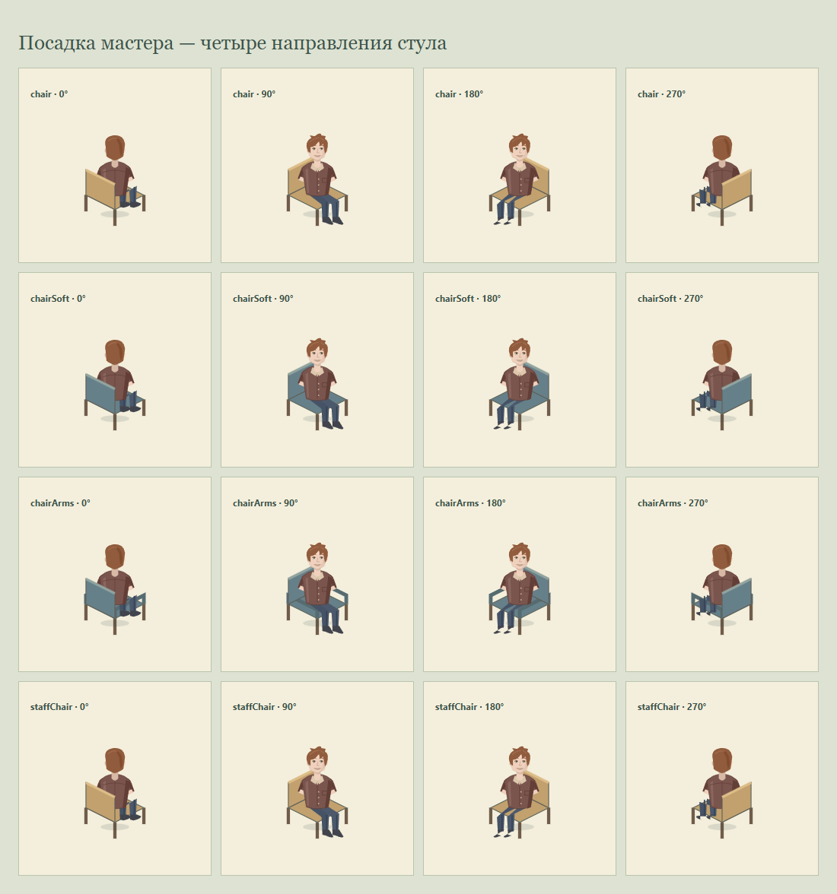
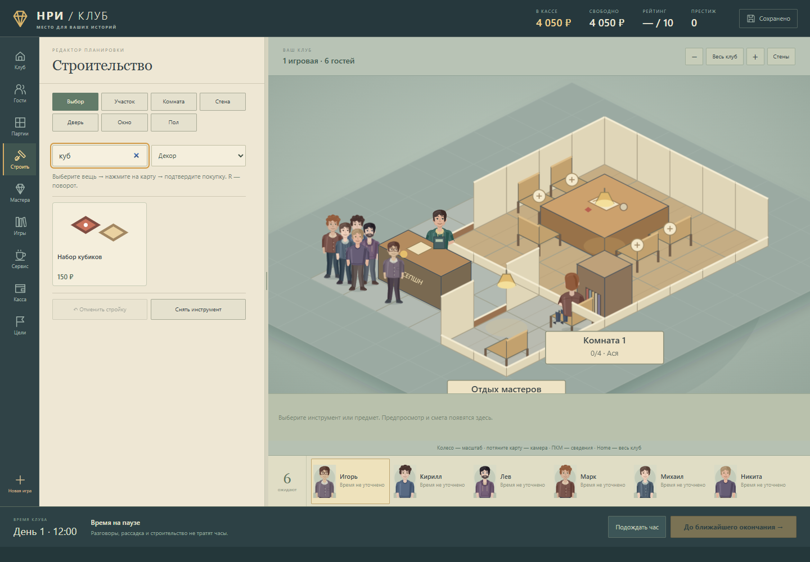

# Приключения, экономика и удобство — 20 октября 2026

Обновление опубликованной переделки `e393420`. Запрос пользователя: понятные иконки предметов, более удобный интерфейс, правильная посадка мастера, длительность от приключения и окупаемая почасовая оплата.

- В каталоге 36 предметов показаны их собственные SVG-миниатюры из того же рисунка, что на карте. Карточки расположены в две колонки; доступны поиск по всем категориям, фильтр, закреплённые сведения о выбранной вещи и отмена строительства. Отличия стула с подлокотниками теперь видны на рисунке.
- В библиотеке разделены приключения, игры и купленные комплекты. Поиск не сбрасывает фокус. На карточке истории сразу видны её часы и билет с гостя; покупка разовая, история остаётся в библиотеке.
- Комнаты переключаются короткими вкладками. Вверху панели находятся часы начала и окончания, билет, оценка остатка при четырёх оплатах и запуск. Выбор игры, истории и мастера сохраняется сразу; отдельной кнопки применения нет. Доход, зарплата и содержание раскрываются рядом с расчётом.
- Часы определяются исходным `minutes` приключения. Партия на четыре часа всегда длится четыре часа; произвольное изменение `hours` отвергается и моделью. Незанятые комнаты старого сохранения принимают часы своей истории. Начатые партии сохраняют согласованные длительность и цену.
- Ставка новых партий изменена со 150 на **200 ₽ с гостя за час**. Билеты на 2/4/6 часов стоят **400/800/1200 ₽**. При четырёх оплатах шестичасовая история приносит 4800 ₽ до расходов. Контракт фиксирует тариф и цену в момент старта; повторный расчёт не создаёт второй платёж.
- Предварительный расчёт вычитает зарплату, расходники и долю содержания открытого клуба. Общие расходы делятся между работающими столами по временным интервалам: если соседний стол закончил раньше, его доля больше не распределяется на него. Чаевые и кафе в прогноз не включены. Это оценка при текущем оснащении, а не обещание оплаты всеми гостями; лишние пустые комнаты и приборы продолжают стоить денег.
- Мастер привязан к плоскости сиденья. Его колени и ступни ориентированы по стулу, спинка разделена на задний и передний слои и корректно перекрывает фигурку. Это применяется и за игровым столом, и на месте отдыха.
- Страница задаёт одну версию всей карты модулей, чтобы после обновления браузер не смешивал старую игровую модель с новым интерфейсом. `tools/prepare-entry.mjs` обновляет эту карту при подготовке выпуска.

Проверено **60 сценариев модели** и **22 блока браузерной проверки**, без звука и в изолированных сохранениях. Отчёты: [модель](rework-evidence/model.json), [браузер](rework-evidence/browser.json). Проверки цены и чистого результата на 2/4/6 часов используют контролируемые четыре успешные оплаты без чаевых. Они проверяют арифметику и проведение платежей, а не гарантируют хорошие отзывы случайной компании. Дополнительная техническая кампания с явно добавленным бюджетом покупает четырёхчасовое приключение через интерфейс и проверяет два независимых стола на 2 и 4 часа.

Финальная настройка миниатюр: пустые поля обрезаются по фактическому контуру рисунка, поэтому кубики и другие маленькие вещи видны крупно. Повторная проверка 22 блоков: [отчёт](rework-evidence/icon-browser.json).

