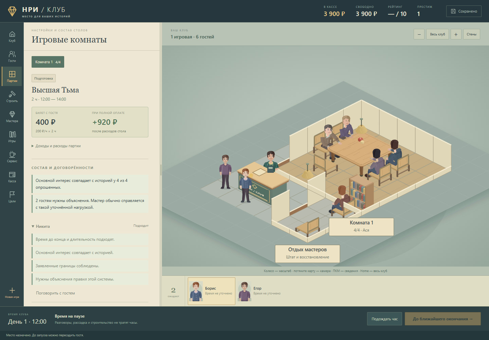
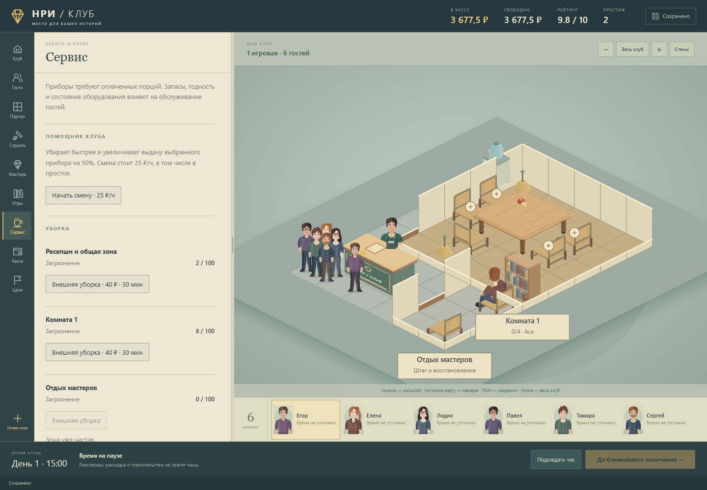

# Экономика клуба · 20 октября 2026

Последующее обновление: [открытый тайкун](OPEN-TYCOON.md). Прежнее условие победы убрано; упоминания пяти комнат и победного рейтинга ниже относятся к состоянию на момент экономического аудита. Расчёты доходов и стоимости решений сохраняют самостоятельный смысл.

Три экономиста отдельно проверили темп развития, покупки и обслуживание, удовольствие гостей и ручную рассадку. Их расчёты использовали настоящие модели игры. Общая приёмка: **109 проверок модели**, **9 браузерных сценариев**, без звука; в конце каждого запуска завершённая квитанция, процессы закрыты.

## Что изменилось для игрока

- «Короткое знакомство» задаёт восемь настоящих вопросов за один разговор. Время и деньги не тратятся. Выбор истории, мастера, четырёх гостей и мест остаётся ручным.
- Перед запуском видны услышанные условия, конфликты и достаточность помощи новичкам. Скрытые предпочтения не раскрываются, готовая идеальная рассадка не предлагается.
- Билет стоит **200 ₽ с гостя за час**, длительность задаётся приключением. При удовольствии 7/10 и выше оплачивается весь билет; ниже оплата плавно уменьшается: 6 → 75%, 5 → 50%, 4 → 25%. Нарушение явного крайнего срока, границ, отказа от жанра или формата означает полный возврат.
- В кассе показаны удовольствие с дробной частью, процент билета, скидка и результат с бонусами/без них. Небольшое улучшение не исчезает за округлённой звездой.
- Стартовые 6 гостей сохранены. Далее приход конечный: 3 человека в час на открытую комнату, каждые полчаса, с ограниченным накоплением. Отказ, загрузка или перестановка не создают новых людей. Кнопка ожидания показывает ближайшее время и расходы.
- Цены и роли оснащения пересчитаны. Дубликаты не множат эффект; предел оснащения +0,80, обслуживания +0,35, вместе +1,00. Материалы помогают объяснять правила; доска с планшетом не складываются. Порции дают комфорт только после реального обслуживания.
- Помощнику можно поручить уборку и назначить конкретный прибор прямо в разделе «Сервис». Наём 600 ₽, смена 25 ₽/ч, включая простой. Уборка одной секции занимает 15 минут и стоит 10 ₽ материалов + 6,25 ₽ зарплаты вместо 40 ₽ внешней уборки. Интерфейс показывает стоимость и время до поручения. Кнопка «До окончания работы или поставки» останавливает часы точно у оплаченной работы: можно сразу закончить смену без лишнего простоя.
- Престиж ограничен: первый предмет вида даёт полный вклад, второй четверть; общий декоративный предел 8, физический 25. Репутация набирается серией отзывов.

Старые подписанные партии сохраняют принятую продолжительность, цену и арифметику V3–V7. История кассы не пересчитывается. Новая зарплата помощника применяется к будущему времени; настройки обычного звука не меняются.

## Темп и цена решений

По 20 одинаковых начальных семян для каждой стратегии, 20 последовательных партий: **1 200 партий**. Уборка, содержание, зарплаты, усталость и износ включены. Деньги не добавлялись. Использованы стартовая история, мастер и одна комната.

| Решения | Медианная касса после 10 / 20 партий | Рейтинг | Медианная партия достижения капитала для второй комнаты с резервом |
|---|---:|---:|---:|
| Первые четыре гостя | 10 266 / 14 657 ₽ | 6,84 | 19 |
| Подбор по семи услышанным ответам | 11 794 / 18 554 ₽ | 7,35 | 15 |
| Точный подбор с полным знанием оценки, только верхний предел | 11 934 / 18 789 ₽ | 7,41 | 14 |

Выбор по ответам даёт около **3 900 ₽** и четырёх партий темпа. Во всех 20 осмысленных кампаниях накоплен безопасный капитал, у первых четырёх — в 12 из 20. Речь о достижении капитала 14 660 ₽, а не о автоматически построенной комнате. Реальная покупка второй комнаты отдельно проверена на явно обозначенном техническом бюджете. Ни одна стратегия этой короткой пробы не достигла победного рейтинга 8 и пяти комнат. Обычный цикл не потребовал дополнительных пауз ради прихода гостей; бесконечный бесплатный перебор при этом закрыт.

Это проверка первых 20 партий с фиксированным стартовым оснащением, не доказательство баланса ста партий или субъективного удовольствия любого игрока.

## Покупки и обучение

На каждый вариант покупки проверены одинаковые 1 200 случайных и 1 200 подобранных гостей. Сравниваются две версии той же компании. В статическом подборе используется точная оценка — это верхний предел, в отличие от последовательной кампании выше.

| Покупка | Цена / чистая доплата | Окупаемость подходящих партий в этой выборке |
|---|---:|---:|
| Удобный стол взамен обычного | 2 000 / 1 040 ₽ | 22,85 |
| Кубики | 150 ₽ | 6,71 |
| Коврик | 220 ₽ | 10,96 |
| Миниатюры | 450 ₽ | 19,08 |
| Ширма | 200 ₽ | 11,94 |
| Доска | 700 ₽ | 4,46 |
| Планшет | 1 600 ₽ | 7,62 |
| Одно мягкое место для нуждающегося гостя | доплата 440 ₽ | 8,08 |
| Одно место с подлокотниками для нуждающегося гостя | доплата 540 ₽ | 22,04 |

«Подходящая» означает хотя бы одного реально получившего пользу человека. В смешанном потоке срок дольше. Сразу покупать весь комплект слабее: пересечение аудитории и предел бонусов увеличивают окупаемость до 30,17 подходящих партий. Кондиционер, вода и чай — контекстный комфорт и рейтинг; быстрый денежный возврат для них не обещается.

На одной и той же отобранной учебной четвёрке за три часа Марк оставляет 1 420,50 ₽ после зарплаты, Алина — 1 470 ₽. Мастер без поддержки новичков — 331,50 ₽, то есть убыток после общих расходов 540 ₽. Курс преподавания Аси добавляет 241,50 ₽ за такую партию: около пяти подходящих партий на возврат 1 200 ₽, **после курса**, без учёта упущенной прибыли за 12 часов обучения. На подготовленной компании дорогой преподаватель экономически не нужен.

Кафе зависит от потока. При пяти любителях кофе ручная машина даёт около 42,39 ₽ маржи/ч, автомат 58 ₽/ч до ремонта и списаний; в первой комнате с одним любителем — 9,20 и 6,80 ₽/ч. Ранний автомат хуже. Помощник полезен уборкой, обычная кофейная очередь его зарплату не покрывает. Уборку и смену надо назначать, приборы требуют запасов.

## Расчёты и воспроизведение

- [Экономист развития](economy-evidence/economist-progression.md).
- [Экономист покупок и эффектов](economy-evidence/economist-purchases.md).
- [Экономист гостей, обучения и рассадки](economy-evidence/economist-guests.md).
- [Числа, ограничения и отпечатки полных локальных отчётов](economy-evidence/audit-summary.json), [модель](economy-evidence/model.json), [браузер](economy-evidence/ui.json).
- [Подтверждение повторного расчёта 1 200 партий](economy-evidence/progression-cohort-identity.json).

Полные промежуточные и итоговые исходные отчёты сохранены в `review/economy-balance`, их пути и SHA-256 указаны в сводке. В публикации оставлены сводка, три аудита, проверочные квитанции и отпечатки полных локальных отчётов. Сценарий повторной проверки создаёт вымышленных гостей локально из исходного детерминированного семени; подробные профили отдельным файлом не публикуются. Финальная редактура одной фразы о наглядных материалах отдельно зафиксирована в [wording-only.json](economy-evidence/wording-only.json): обратная замена побайтово восстанавливает проаудированный файл, арифметика не менялась.

Повторяемые сценарии находятся в `tools/probe-economy-progression.mjs`, `probe-economy-purchases.mjs`, `probe-economy-guests.mjs`, `probe-economy-teaching.mjs`. Модель — `tools/model-review.mjs`; интерфейс — `tools/review-economy.mjs`, также поддерживает `--url`. Передавать `-noaudio --out <новый отчёт>`. На этом компьютере запускать через `E:/Game/Tools/Run-QuietGameCheck.ps1`; браузер использует `ReviewAudioSilence`, `--mute-audio` и включённую защиту Chromium. Процесс без завершённого успешного отчёта успешной проверкой не считается.
