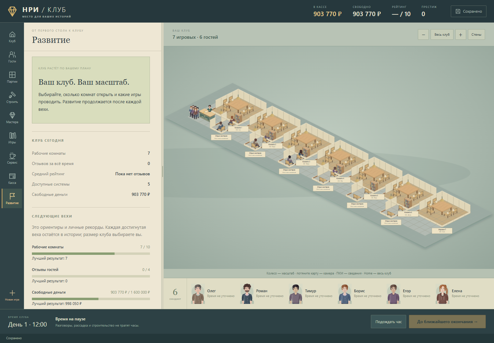

# Открытый тайкун · 20 октября 2026

Размер клуба выбирает игрок. Число комнат больше не завершает игру. Вместо общей проверки «5 комнат + 100 отзывов + рейтинг + деньги + системы» работают независимые вехи развития и история рекордов.

## Текущее поведение

- Новый клуб сразу находится в открытом режиме. После пятой, шестой и следующих комнат игра продолжается обычным образом; кнопка перехода в свободную игру убрана.
- «Развитие» показывает текущие комнаты, отзывы, рейтинг, доступные системы и свободные деньги. Достигнутые вехи сохраняются, следующие продолжают расти. Закрытие комнаты или покупка не стирают уже полученную отметку.
- Вехи не дают деньги, не рассаживают гостей, не запускают партии и не выбирают масштаб клуба. Открывать новые комнаты, работать небольшим составом или развивать оснащение — решение игрока.
- Начальный авторский список мастеров сохранён. Когда в нём остаётся меньше шести ненанятых людей, появляются следующие восемь кандидатов. Последующий наём продолжает список; единого конечного числа мастеров нет. Новые люди имеют постоянные идентификаторы, портреты, знания, способности, цену и зарплату. Перезагрузка не меняет предложение; возвращающийся сотрудник сохраняет обучение и стаж.
- Убыточный клуб по-прежнему требует решения игрока: закрытия пустых комнат, продажи лишнего или восстановления. Условия долгов и банкротства сохранены.
- Старые сохранения с отметкой победы открываются в этом же режиме. Деньги, комнаты, мебель, гости, текущие договоры и финансовая история сохраняются; прежняя отметка завершения остаётся историческим фактом в сохранении.

## Большая карта

Обзор «Весь клуб» теперь может уменьшать масштаб ниже прежних 0,35: он охватывает весь купленный участок. Убраны повторные проверки всех мест отдыха для каждой единицы мебели при перерисовке. Размещение фигурок использует тот же расчёт доступных мест, выполненный один раз для кадра. Панель сотрудников также использует общий результат.

Модель не вводит игровую квоту комнат. Техническая проверка планировки и сохранения остаётся: реальные размеры ограничиваются памятью и производительностью браузера. Проверенный сценарий ниже подтверждает конкретный масштаб, а не бесконечную производительность.

## Проверка

- **117 проверок модели**, включая рост вех после 5, 100 и 1 000 комнат, сохранение рекордов, миграцию старой победы, идущий договор и продолжение списка кандидатов. Проверка счётчика на 1 000 не является проверкой отрисовки тысячи комнат.
- Через настоящие платные модели строительства, найма и покупок получены **6 полностью работающих комнат**, с физическими местами отдыха и отдельными играми.
- В браузере через обычные кнопки и мышь нарисована и куплена **седьмая комната**, нанят мастер и куплена игра. Семь рабочих комнат сохраняются и загружаются, время продвигается, посетители продолжают приходить.
- Проверены импорт старого сохранения с победой, обычное начало, узкий экран и отсутствие отдельного окна завершения.
- Проверен обзор купленного участка **шириной 142 клетки**, масштаб около 0,16: оба конца остаются в кадре.

Технический сценарий строительства явно использует добавленный проверочный бюджет в 1 000 000 ₽. Он проверяет доступность действий и геометрию; скорость заработка на семь комнат из него не выводится. Экономические расчёты предыдущего обновления сохранены отдельно в [ECONOMY-BALANCE.md](ECONOMY-BALANCE.md).

Все запуски выполняются через тихую проверочную оболочку, с `-noaudio`, `ReviewAudioSilence`, `--mute-audio` и включённой защитой Chromium. Квитанции, отчёты и отпечатки принятых исходников находятся в `endless-evidence`. Полные промежуточные отчёты сохраняются в локальном `review/endless-*`.

Начальный браузерный сценарий с шестью комнатами занял 164 секунды. После удаления повторных расчётов расширенный сценарий с дополнительной проверкой широкого участка завершился примерно за 26 секунд на той же среде. Это время всего сценария, включая импорт, покупки, сохранения и снимки; не замер частоты кадров.
