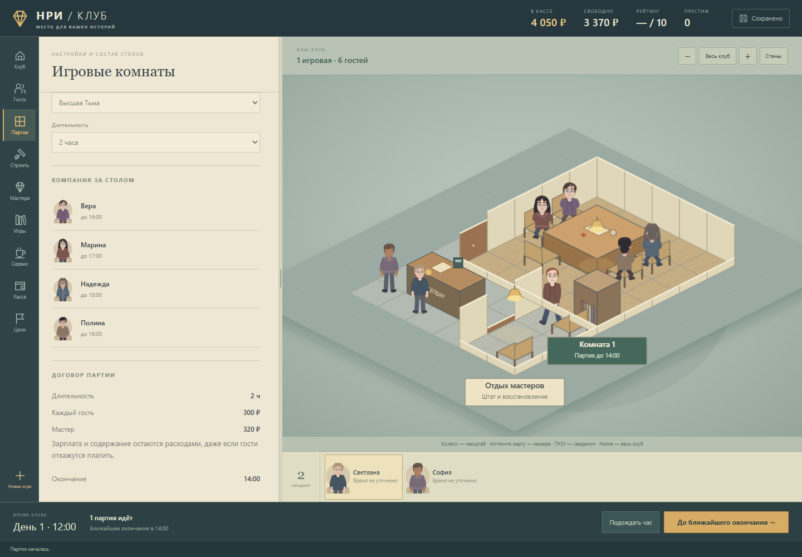
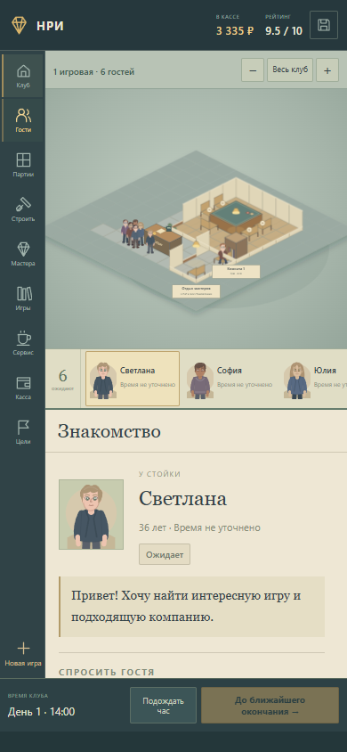

# Переделка НРИ-Клуб-Тайкун — 20 октября 2026

Основа: опубликованная N5, коммит `912f32b2926b0f3ea7d0b42ec16b5ca13bac1d31` репозитория `regmoviee-byte/nri-club-tycoon`. Новая точка входа использует `src/ui/studio.js`, `studio.css`, `world.js` и `people.js`. Исторические модули интерфейса оставлены в исходниках, но новая страница их не загружает.

## Что изменилось

- Единый интерфейс с десятью разделами, постоянной картой, очередью, часами и состоянием сохранения. Разговоры, покупки, отзывы, настройки и подтверждения встроены в боковую панель. Отдельных игровых окон нет.
- Физический ресепшн и очередь у входа. Доступность стойки определяет новые поступления гостей. Игрок разговаривает с гостями и рассаживает их по конкретным стульям; персонажи идут по доступным клеткам и дверям.
- Карта с перемещением мышью, клавиатурой и касанием, масштабом у указателя, щипком, возвратом ко всему клубу и изменяемой шириной панели. Новые векторные предметы, портреты и анимации персонажей используют одну систему координат.
- Покупка выбранных клеток земли по 125 ₽, рисование прямоугольных комнат, комплект готовой игровой, стены, двери, окна и пол. У предметов есть поворот, перемещение, продажа, предпросмотр и проверка коллизий. Коврик занимает стол целиком и поддерживает дополнительные настольные аксессуары. Покупка сохраняет геометрию и деньги одной операцией; доступна отмена последнего строительства.
- Все 36 типов предметов каталога имеют показанный в магазине эффект: места и вместимость, отдых, хранение, свет, комфорт, сервис, игровые материалы либо ограниченный физический престиж. Престиж учитывает доступность и состояние предмета, ограничен двумя экземплярами одного типа и участвует в доступности дорогих мастеров. Оборудование не отменяет ошибки подбора гостей и нарушения времени.
- Игровые комнаты независимо выбирают систему, приключение, мастера и длительность. Доступны библиотека и спрос, покупки экземпляров, износ и ремонт, найм, отдых и обучение мастеров. Накопленные известные предпочтения и прошлые отзывы постоянных гостей видны в панели. Время ухода уточняется при каждом новом визите.
- Убрана обязательная неоплачиваемая 15-минутная подготовка после каждой партии. Износ комплектов и оплачиваемый ремонт остаются. Ранее начатые договоры сохраняют свою версию расчёта оценки; новые используют версию 7 с ограниченными бонусами оснащения.
- Сервис показывает оборудование, оплачиваемые поставки, партии запасов и сроки годности, уборку, износ, помощника и автозакупку с целевым запасом и бюджетом. Стоимость уборки общей зоны учитывает фактическую площадь купленных клеток.
- Касса раскрывает платежи и отзывы по гостям, расходы, обслуживание и план финансового восстановления. Восстановление сохраняет возможность принимать гостей через доступный ресепшн.
- Существующее защищённое хранилище используется и новым интерфейсом: автоматическое сохранение, архив при явной замене кампании, перенос файлом, проверка ошибочного импорта, блокировка второго пишущего окна. Повреждённая запись не уничтожается при запуске.

## Проверено

Итоговые отчёты: [модель](rework-evidence/model.json), [браузер](rework-evidence/browser.json). Оба отчёта закончены и успешны. Проверки запускались через `E:/Game/Tools/Run-QuietGameCheck.ps1`; дочерние процессы завершаются при выходе, ошибке или прерывании. Передан `-noaudio`, в Chromium — `--mute-audio`, а `ReviewAudioSilence` устанавливается до загрузки приложения и сохраняет тишину после событий фокуса.

**50 проверок модели:** все 36 предметов в четырёх поворотах; физический ресепшн; стоимость и связность земли; повтор операции без второго списания; откат при ошибке сохранения; устаревшая смета; наложение настольных аксессуаров; комната и проходы; ограничения престижа и оценок; последовательные партии; точность проекции и маршрут до каждого стула; площадь уборки и восстановление клуба.

**17 блоков браузерного сценария:** десять разделов без диалоговых окон и лишних полос прокрутки; панорамирование, привязанный к курсору масштаб, Home и размер панели; разговор, перетаскивание, рассадка и движение гостя; окончание партии и реальные платежи; покупка предмета и земли с проверкой денег; поворот в русской раскладке и отмена; коврик и кубики; экспорт, импорт, перезагрузка и новая игра; экраны 390 и 320 пикселей; настоящее сенсорное масштабирование; восстановление повреждённого сохранения.

Отдельная техническая кампания с явно добавленными **75 000 ₽ тестового бюджета** проверяет постройку и доступ второй комнаты, покупку второго экземпляра игры, найм мастера, запас гостей в 1,5 раза больше мест, параллельные сессии на 2 и 3 часа с однократным расчётом, а также оборудование, оплаченные заказы, доставку запасов и помощника. Этот бюджет не заработан в игровой кампании и не является проверкой экономического баланса.

Для повторения проверки модели достаточно Node.js 22+ и `npm test`. Для браузера нужен Playwright: `tools/review.mjs` по умолчанию загружает `playwright-core`; `PLAYWRIGHT_MODULE` позволяет указать другой установленный модуль, а `PLAYWRIGHT_CHROMIUM_EXECUTABLE` — путь к Chromium. Аргументы: `-noaudio --out <путь-к-новому-report.json>`. Для проверок в рабочем окружении проекта обязателен указанный выше процессный контроллер; не запускайте браузерный сценарий в обход него. Модельный отчёт создаётся аналогично через `tools/model-review.mjs`.

## Границы версии

Это отдельная версия для просмотра. Основная ветка и опубликованная N5 ещё не заменены. В исходной базе остаются **10 игровых систем и 36 приключений**; отсутствующий обзор сотен игр не восстановлен из предположений. Новый рисунок персонажей и мебели требует визуальной оценки пользователя. Длительный баланс кампании и каждый из исторического списка дефектов не объявляются проверенными на основании этих сценариев.

Старые записи сохранений и материалы проекта сохраняются. Для переноса кампании между адресами нужен явный экспорт/импорт файла; тесты использовали изолированные новые хранилища, а не сохранения игрока.

## Снимки

