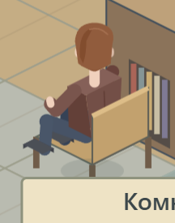
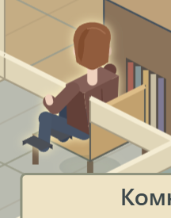
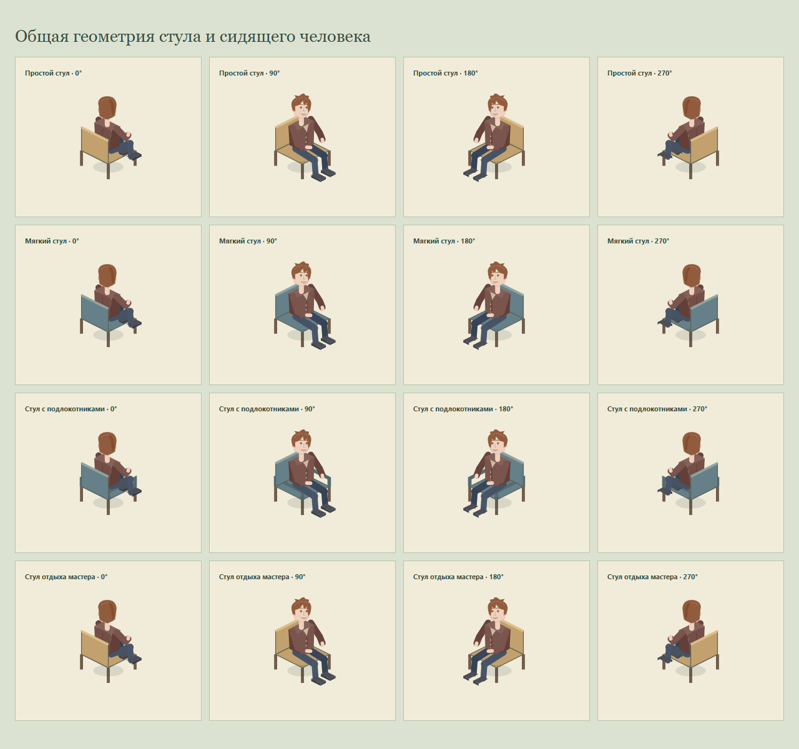

# Посадка мастера по геометрии стула

На присланном снимке мастер в комнате отдыха действительно смотрел в сторону, противоположную стулу. Предыдущая проверка отдельной иллюстрации не подтверждала правильную посадку в настоящей комнате.

Сидящая фигурка теперь строится в системе координат самого стула: общие направление, высота сиденья и положение спинки. Корпус, бёдра, колени, ступни и голова поворачиваются вместе. Для ближайшей к камере спинки её передний слой перекрывает спину фигурки. Точка посадки находится в центре реального стула; отдельное смещение плоской фигурки больше не используется. Это применяется к мастерам и гостям на игровых стульях и к мастерам на местах отдыха, включая завершение анимации ходьбы.

Проверка настоящей игровой сцены прошла от отдыха к партии и обратно, со сменой панелей и перезагрузкой сохранения. Крупный план захватывает целиком человека и его стул. Дополнительно просмотрены четыре направления для четырёх видов стула. Проверки выполнены без звука, с изолированным сохранением и завершением всех принадлежащих запуску процессов.

- [7 блоков проверки посадки](seating-evidence/report.json)
- [60 проверок модели](seating-evidence/model.json)
- [22 блока проверки игрового интерфейса](seating-evidence/browser.json)

Обычный запуск Chromium был отклонён Windows с кодом доступа `0xC0000022`. Браузерные проверки выполнены разрешённым запуском через `Run-QuietGameCheck.ps1`, с включённой песочницей Chromium и принудительной тишиной.

Комната отдыха в настоящей игре, стены скрыты для обзора стула:

После партии и возвращения, с обычным отображением стен:

