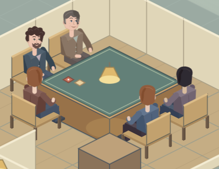
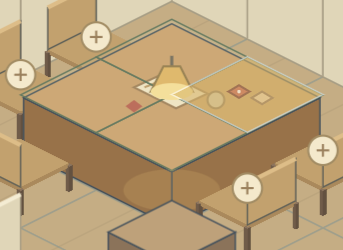

# Полный стол и привязка настольных предметов

Проверена настоящая игровая партия с четырьмя гостями и мастером одновременно. После завершения ходьбы все пять фигурок находятся в центрах пяти разных стульев, используют их направление и перекрытие ног геометрией стула. Все пять мест обращены к столу. Посадка и расположение настольного предмета сохраняются после перезагрузки.

Настольные предметы уже хранились в целых координатах сетки. У стола четыре ячейки: аксессуар занимает одну, коврик — весь стол, ширма привязывается к краю в соответствии с поворотом. Подсветка выбранной ячейки раньше находилась на полу под столом. Теперь она находится на столешнице; при выборе или переносе настольного предмета показаны четыре ячейки поверхности. После снятия инструмента или перехода из строительства сетка скрывается.

Предпросмотр ширмы теперь использует разрешённую геометрию её привязки даже при отказе из-за занятого места. Существующая проверка не разрешает размещать два аксессуара в одной ячейке, а отказ не списывает деньги. Коврик совместим с аксессуарами поверх него.

Без звука выполнены 62 проверки модели и геометрии, 22 блока общей браузерной проверки и [6 блоков проверки стола](table-evidence/report.json). Последние включают реальные движения указателя после масштаба и перемещения камеры, покупку кубиков и коврика, перенос сохранённого предмета, отказ при занятой ячейке, четыре поворота ширмы, пять сидящих персонажей и перезагрузку. Для миниатюр, планшета и ширмы проверен предпросмотр; кубики и коврик куплены через интерфейс с обычным стартовым бюджетом. Изменения не требуют преобразования сохранений.
